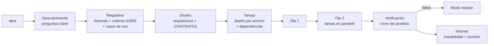
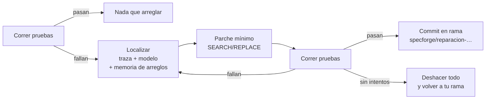

# SpecForge


**Agentes de IA que trabajan como un equipo de software: primero las especificaciones, después el código, y los arreglos se comprueban con las pruebas.**

> **🇬🇧 In English — at a glance**
>
> SpecForge is a Python multi-agent tool with two modes:
>
> - **`generar` (generate)** — *spec-driven development*: an idea becomes user stories with EARS acceptance criteria and use cases → a design with explicit **contracts** → a task plan where every file has one owner → parallel implementation in **waves** (each agent gets only the context its task needs) → optional test run → traceability report (criterion → task → files).
> - **`reparar` (repair)** — an *Agentless*-style loop on a **real git branch**: reproduce the failing tests → localize (stack trace + model) → minimal SEARCH/REPLACE patch → re-run the tests; repeat or roll back. Past fixes are remembered (SQLite FTS5) and reused for similar errors.
>
> | Design point | Where to look |
> |---|---|
> | Stage artifacts validated on arrival (unique IDs, existing references, no dependency cycles, one owner per file, criteria coverage) | [`specforge/artefactos.py`](./specforge/artefactos.py) |
> | Wave scheduler: dependencies + read/write conflicts decide what runs in parallel | [`specforge/planificador.py`](./specforge/planificador.py) |
> | Generate pipeline with minimal per-task context | [`specforge/generar.py`](./specforge/generar.py) |
> | Repair loop with git safety (own branch, rollback, only edited files committed) | [`specforge/reparar.py`](./specforge/reparar.py) |
> | **Provider router with automatic fallback** — free tiers (Gemini, Groq, Cerebras, OpenRouter, GitHub Models, NVIDIA) and personal subscriptions through their CLIs (Claude Code, Antigravity CLI for Google AI Pro) | [`providers/`](./providers) · [`core/config.py`](./core/config.py) |
> | Optional Telegram bot (long polling, single allowed chat, repair limited to declared repos) | [`specforge/telegram.py`](./specforge/telegram.py) |
> | 102 pytest tests, including end-to-end runs that generate a project and repair a real git repo with real test runs | [`tests/`](./tests) |

---

## Cómo funciona

### Modo `generar`: de una idea a un proyecto



| Etapa | Qué produce | Por qué así |
|---|---|---|
| **Descubrimiento** | 2–4 preguntas que cambian el alcance | Evita que la IA adivine lo importante |
| **Requisitos** | Historias de usuario (HU), criterios de aceptación en formato **EARS** (`CUANDO … EL SISTEMA DEBE …`) y **casos de uso** con flujo principal y alternos | Cada criterio se puede comprobar con una prueba |
| **Diseño** | Stack, componentes, modelo de datos, **contratos** (rutas, firmas, errores) y comandos | Los contratos son lo que deja trabajar en paralelo sin que los agentes se contradigan |
| **Tareas** | Porciones de funcionalidad del tamaño de un *pull request*, cada una con sus archivos, lo que lee, sus dependencias y su condición de terminado | Ni "crear archivo X" (la IA pierde el porqué) ni "hacer el backend" (la IA se confunde) |
| **Implementación** | Un agente por tarea; las tareas de una misma **ola** corren a la vez (3 por defecto) | Cada agente recibe solo sus historias, sus criterios, los contratos y los archivos que declara leer |
| **Verificación** (opcional) | Instala y corre las pruebas; si fallan, pasa al modo reparar | El código se comprueba de verdad, no solo se revisa |
| **Informe** | Matriz criterio → tarea → archivos, y una revisión final | Se ve qué quedó cubierto y qué no |

Todo queda en `<proyecto>/specs/` como Markdown (para leer) y JSON (para la máquina).

**Reglas que se validan automáticamente** (si el modelo las rompe, se le pide corregir con el error exacto): IDs únicos, historias y criterios que existen, dependencias sin ciclos, **cada archivo con una sola tarea dueña**, rutas seguras (nada fuera del proyecto) y todos los criterios cubiertos por alguna tarea. Si un agente intenta escribir un archivo de otra tarea, se rechaza y queda en el informe.

### Modo `reparar`: arreglos comprobados con las pruebas



Basado en *Agentless* (Xia et al., 2024): un proceso fijo de localizar → parchear → validar resolvió más problemas que agentes autónomos complejos y costó menos.

- Trabaja en una **rama nueva de git**; tu rama no se toca. Exige que no haya cambios sin guardar.
- Si lo arregla, hace commit **solo de los archivos editados** en esa rama, para que lo revises y lo unas.
- Si no lo logra en los intentos dados (3 por defecto), deshace todo y te devuelve a tu rama.
- Cada intento le dice al modelo qué se probó antes para no repetirlo.
- **Memoria:** guarda cada arreglo exitoso (SQLite FTS5) y, ante un error parecido en el mismo repositorio, se lo muestra al modelo al localizar.

---

## Inicio rápido

```bash
git clone https://github.com/yoesitooo/SpecForge.git
cd SpecForge
```

**Windows:** doble clic en `instalar.bat`. **Linux / macOS:** `./instalar.sh`.
Crea un entorno virtual, instala SpecForge con sus **2 dependencias** (`httpx`, `python-dotenv`) y el comando `specforge`, copia `.env.example` a `.env` y prueba los proveedores.

Luego pon en `.env` al menos una clave gratis (por ejemplo `GEMINI_API_KEY`) o inicia sesión en tus CLIs (ver **Modelos**).

La forma más fácil: escribe **`specforge`** sin nada más y te sale un menú:

```
SpecForge — ¿qué quieres hacer?
  1) Generar un proyecto desde una idea
  2) Reparar un proyecto cuyas pruebas fallan
  3) Ver qué proveedores de IA responden
  4) Encender el bot de Telegram
  0) Salir
```

(En Windows: `specforge.bat`, o activa el entorno con `.venv\Scripts\activate` y escribe `specforge`. En Linux/macOS: `source .venv/bin/activate`.)

Con comandos directos:

```bash
# Generar un proyecto (hace preguntas primero; --sin-preguntas para saltarlas)
specforge generar "agenda de citas para un consultorio odontológico" --verificar --reparar

# Arreglar un repositorio cuyas pruebas fallan
specforge reparar ../mi-proyecto --prueba "pytest -q"
specforge reparar ../mi-web --prueba "npm test" --intentos 4

# Ver qué proveedores de IA responden
specforge diagnostico
```


---

## Bot de Telegram (opcional): usarlo desde el celular

Cada persona crea **su propio bot**; corre en su computador (no necesita servidor ni abrir puertos) y solo le responde a su dueño.

1. **Crea el bot.** En Telegram busca **@BotFather** (con el check azul), escribe `/newbot`, elige un nombre y un usuario que termine en `bot`. Te da un **token**.
2. **Obtén tu ID.** Escríbele a **@userinfobot**; te responde con tu número de ID.
3. **Configura `.env`:**
   ```bash
   TELEGRAM_TOKEN=el-token-de-botfather
   TELEGRAM_ALLOWED_CHAT_ID=tu-id
   # Opcional: proyectos que el bot puede reparar, cada uno con SU comando de pruebas
   SPECFORGE_REPOS=lexai=C:/code/LexAI|npm test; api=/home/yo/api|pytest -q
   ```
4. **Enciéndelo:** `specforge telegram` (o la opción 4 del menú). Déjalo abierto mientras lo uses.
5. **Escríbele a tu bot:**

| Comando | Qué hace |
|---|---|
| `/generar <idea>` | Crea el proyecto, te avisa cada etapa y te envía el informe |
| `/reparar <nombre>` | Arregla un proyecto de `SPECFORGE_REPOS` y te envía el resultado |
| `/proyectos` | Lista los proyectos que se pueden reparar |
| `/estado` | Qué está haciendo |

**Seguridad.** El bot ejecuta trabajo en tu computador, así que:
- sin `TELEGRAM_ALLOWED_CHAT_ID` **no arranca**, y los mensajes de otros chats se ignoran;
- desde Telegram no se puede escribir un comando ni una ruta: `/reparar` solo acepta nombres de `SPECFORGE_REPOS`, con el comando de pruebas que tú definiste;
- `/generar` crea archivos en la carpeta de proyectos pero **no ejecuta** el código generado (la verificación se hace desde la terminal con `--verificar`);
- hace un trabajo a la vez. Si el token se filtra, revócalo con `/revoke` en @BotFather.

---

## Modelos: gratis o con tus suscripciones

No hace falta pagar: **basta con una clave gratis**. Cada etapa pide un *nivel* y el router recorre una cadena de proveedores; si uno no tiene clave, llega a su límite gratis (HTTP 429) o se cae, pasa solo al siguiente.

| Proveedor | Cómo se usa | Costo |
|---|---|---|
| **Gemini** (Google AI Studio) | `GEMINI_API_KEY` — [aistudio.google.com/apikey](https://aistudio.google.com/apikey) | Plan gratis, sin tarjeta (Flash y Flash-Lite) |
| **Groq** | `GROQ_API_KEY` — [console.groq.com/keys](https://console.groq.com/keys) | Plan gratis, muy rápido |
| **Cerebras** | `CEREBRAS_API_KEY` | Plan gratis |
| **OpenRouter** | `OPENROUTER_API_KEY` | Modelos `:free` |
| **GitHub Models** | `GITHUB_MODELS_TOKEN` | Gratis con cuenta de GitHub |
| **NVIDIA NIM** | `NVIDIA_API_KEY` | Créditos gratis |
| **Antigravity CLI** (`agy`) | Iniciar sesión una vez con `agy` | Cuenta de Google; más límite con **Google AI Pro/Ultra** |
| **Claude Code CLI** (`claude`) | Iniciar sesión una vez con `claude` | Plan **Claude Pro/Max** |

**Sobre Google AI Pro:** la suscripción no sube los límites de la API de Gemini (eso va por AI Studio), pero sí los del CLI de Google, que desde junio de 2026 es **Antigravity CLI** (`agy`, reemplazó a Gemini CLI para cuentas personales). SpecForge lo ejecuta en modo *headless* (`agy -p`, salida JSON), sin shell y sin permisos para editar archivos. Las suscripciones son para uso personal; para un servicio con usuarios, usa las APIs.

`SPECFORGE_MODO` en `.env`:

| Modo | Qué usa |
|---|---|
| `auto` (por defecto) | Tus cuentas primero; si no tienen sesión o llegan a su límite, las APIs gratis |
| `cuentas` | Solo Claude Pro / Google AI Pro |
| `gratis` | Solo APIs con plan gratis |

**Qué modelo usa cada etapa** ([`core/config.py`](./core/config.py)). Con Claude Pro y Google AI Pro, Claude va donde importa la calidad y hay pocas llamadas; la cuenta de Google, con más consultas al día, va donde hay muchas:

| Nivel | Etapas | Cadena por defecto |
|---|---|---|
| `deep` | diseño, revisión | claude → antigravity → gemini-3.8-flash → groq gpt-oss-120b |
| `code` | implementación, parche | claude → antigravity → gemini-3.8-flash → groq gpt-oss-120b |
| `smart` | descubrimiento, requisitos, tareas | antigravity → claude → gemini-3.8-flash → groq gpt-oss-120b → groq llama-3.3-70b |
| `fast` | localizar errores | antigravity → gemini-3.5-flash-lite → groq llama-3.1-8b → groq gpt-oss-20b |

Cualquier nivel se cambia desde `.env`, por ejemplo `SDD_CHAIN_SMART=gemini:gemini-3.8-flash,cerebras:gpt-oss-120b`.

`python -m specforge diagnostico` hace una llamada real a cada proveedor configurado:

```
Modo actual: SPECFORGE_MODO=auto
  ✓ antigravity (cuenta, modelo por defecto): «listo» en 4.2 s
  ✓ claude (cuenta, sonnet): «listo» en 6.8 s
  ✓ gemini (API, gemini-3.8-flash): «listo» en 0.9 s
  — groq (API): sin clave en .env
```

---

## Estructura

```
SpecForge/
├── specforge/
│   ├── __main__.py      # CLI: menú interactivo · generar · reparar · diagnostico · telegram
│   ├── telegram.py      # bot opcional (long polling, chat restringido)
│   ├── generar.py       # proceso de especificación → tareas → código en olas
│   ├── reparar.py       # reproducir → localizar → parche → validar (en rama git)
│   ├── artefactos.py    # requisitos, diseño y plan: validación y Markdown
│   ├── planificador.py  # olas en paralelo sin conflictos de archivos
│   ├── prompts.py       # instrucciones de cada etapa
│   ├── espacio.py       # escritura segura de archivos y ediciones
│   ├── pruebas.py       # correr pruebas sin shell y leer trazas
│   └── llm.py           # llamada por etapa + JSON validado con reintento
├── providers/           # router con respaldo, APIs OpenAI-compatibles, CLIs de suscripción
├── memory/engram.py     # memoria SQLite FTS5 (decisiones y arreglos)
├── skills/              # guías por tecnología que se inyectan en el diseño
├── core/config.py       # niveles, cadenas y modos
└── tests/               # 102 pruebas (pytest)
```

## Pruebas

```bash
pip install -r requirements-dev.txt
python -m pytest -q tests
```

No llaman a ningún modelo: una IA simulada responde con guiones. Cubren la validación de artefactos, el planificador, la escritura segura, el router con respaldo, los CLIs y dos recorridos completos:

- **Generar:** produce un proyecto Python de 4 tareas en 3 olas (2 en paralelo), comprueba que cada agente recibe solo su contexto, que se rechaza un archivo ajeno y que **las pruebas generadas pasan de verdad** con pytest.
- **Reparar:** sobre un repositorio git real con un error, lo arregla en una rama y deja `main` intacta; si no puede, deshace todo; recuerda el arreglo para la próxima vez.

Corren en GitHub Actions en cada push.

## Limitaciones honestas

- La calidad del código depende del modelo: con modelos gratis pequeños, las tareas grandes pueden salir incompletas (el informe lo marca).
- El modo reparar necesita un comando de pruebas que reproduzca el error; sin pruebas, no tiene cómo validar.
- La verificación de proyectos generados instala dependencias: necesita Python/Node según el stack elegido.

## Origen

Empezó como [agente_html](https://github.com/yoesitooo/agentes_de_ia), un solo agente que generaba páginas HTML. Luego fue un orquestador de 11 agentes con asistente de voz; esta versión se enfocó en lo que más sirve: especificar bien, trabajar en paralelo sin choques y arreglar con pruebas.

## Licencia

MIT.
